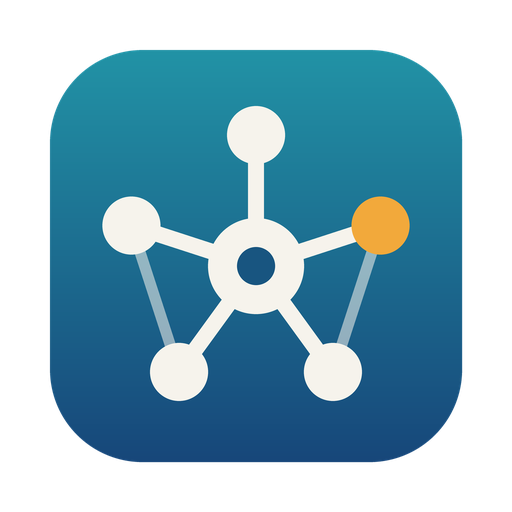

# Nodo



Map and track the devices on your networks — your LAN, your Tailscale tailnet, your AWS VPCs and
Client VPN, your WireGuard tunnels — as a living graph. Who is there, what it is, whether it is up,
and what you know about it. *Nodo* is Spanish for *node*.

Native desktop app in Rust with [GPUI](https://www.gpui.rs/) and
[gpui-component](https://github.com/longbridge/gpui-component). macOS, Windows and Linux. UI in
Spanish, English, Portuguese and French. Plus `nodo`, a headless command line on the same engine,
for scripts and AI agents.

## Features

- **Graph**: the gateway / router in the centre, subnets and networks as hubs, every device around
  them. Layers for **LAN**, **Tailscale**, **AWS** and **WireGuard**, each its own colour and each
  toggleable; a device on several networks (your laptop on the LAN and the tailnet) gets a dashed
  edge to its other networks. Offline devices are greyed, down ones red. Three layouts: **radial**,
  **by subnet** (a box per subnet) and **by network** (a column per layer). Drag or scroll to pan,
  ⌘ + scroll, pinch or ⌘± to zoom, ⌘0 fits the map. **List** mode (⌘L) sorts by status, name,
  type, IP, network or last seen. **Search** (⌘F) by name, IP, MAC, vendor, model, owner, tag or
  note: everything else fades; Enter jumps to the first match. A side panel shows the selected
  device.
- **Discovery, passive first**:
  - the neighbour table (`arp -an` / `ndp -an` on macOS, `/proc/net/arp` and `ip neigh` on Linux,
    `arp -a` on Windows), with the MAC vendor from an embedded, compressed copy of the IEEE OUI
    registry (offline);
  - mDNS / Bonjour (`_http`, `_ssh`, `_smb`, `_ipp`, `_airplay`, `_googlecast`, `_hap`,
    `_homeassistant`, `_device-info` and 20 more): names, models, services;
  - SSDP / UPnP: one `M-SEARCH`, then each device description (friendly name, maker, model, web
    page) fetched from private addresses only.

  Passive discovery runs when a map opens and every 5 minutes while it is open (can be turned off).
- **Active scan, only when you ask** (*Scan subnet…*): one ping and a TCP connection attempt to
  22, 80, 443, 445, 3389, 5900, 8080, 9100 and 554 for each address of the current /24, 32 hosts at
  a time and at most 400 attempts per second; open ports hint the device type. Private ranges only,
  with a clear *only scan networks you own or administer* warning before it starts.
- **Tailscale**: `tailscale status --json` from the CLI on your PATH or inside
  `/Applications/Tailscale.app` (or `~/Applications`): every node with its name, addresses, OS,
  online state, exit node, tags, owner (the tailnet user's name; group the list by owner) and
  whether the connection is direct or relayed. When Tailscale is installed it runs with every
  refresh (on open, ⌘R and every few minutes); the side panel's Sources section shows
  "Tailscale: 12 devices · updated 10:42" or what went wrong.
- **AWS**, read-only, through **your own AWS CLI** and profile (SSO works): `aws ec2
  describe-vpcs / describe-subnets / describe-instances / describe-security-groups /
  describe-client-vpn-endpoints --output json`, for the regions you choose. VPCs and their subnets
  become networks, instances and Client VPN endpoints devices, with type, state, AZ, public IP and
  security groups. Nodo never sees, asks for or stores credentials; an expired SSO session is
  explained (`aws sso login --profile …`).
- **WireGuard**: `wg show all dump` — interfaces become networks, peers devices (allowed IPs,
  endpoint, last handshake). Reading it usually needs root; Nodo then shows the
  `sudo wg show all dump > ~/nodo-wg.txt` command and imports that file.
- **Inventory**: name, type (router, switch, access point, server, NAS, camera, printer, TV,
  speaker, phone, tablet, laptop, desktop, IoT, VM / instance, VPN), owner, location, tags, notes,
  links (the web UI), custom fields, several IPs and MACs per device. **Saved** devices stay on the
  map (greyed) while offline. A device is **one device across IP changes**: it is recognised by
  MAC, Tailscale node, AWS instance id, WireGuard key or mDNS name before its IP, and an address
  that moved to another machine is taken from the old one. A LAN machine and its Tailscale node
  join when their host name is unambiguous, when the node's LAN endpoint is the machine's address,
  and for this computer itself, so each appears once on both networks. **Merge** and **split** fix the rest by hand.
- **You are here**: the computer running Nodo is found at runtime from its interfaces (Wi-Fi,
  Ethernet, Tailscale: MACs and addresses), host name and Tailscale node, so a map in a synced
  folder opened on another computer marks that one. It gets an accent halo, a pin and a
  "This Mac" badge on the graph (next to the gateway in the radial layout), a chip and a
  "this computer on top" option in the list, its interfaces in the side panel, a local shell for
  *Open terminal here*, and a line in the footer. It is added to the map on the first refresh even
  when nothing else answers.
- **Virtual machines on this computer**: its VM / container bridges (macOS `bridge1xx` /
  `vmnet`, Linux `docker0`, `br-*`, `virbr*`, Windows `vEthernet`) are drawn as a group hanging
  from this computer, not from the router; its own address there (192.168.64.1) is one of its
  interfaces, and guests are named after the runtime running them when Nodo can tell (Docker
  Desktop, OrbStack, Colima / Lima, UTM, Parallels, VMware, VirtualBox, Multipass, Kiri).
- **Monitoring while the app is open**: saved devices (or any you choose) are checked every 30 s
  (configurable) with the system `ping`, falling back to a TCP connect to a port the device is
  known to answer on. Latency, uptime this session, last seen; a history per device (discovered,
  address changed, down, back up after N minutes, merged, edited). **Alerts** in the app and as a
  system notification for a **new unknown device on the LAN** (the first discovery of a map is the
  baseline, not a flood) and for a **saved device down for N minutes** (5 by default). Pause it
  any time.
- **Services, not only devices**: watch websites and APIs (HTTP / HTTPS: status code, latency,
  a keyword the page must contain, TLS certificate expiry), TCP ports, DNS names and pings, each
  at its own interval, attached to a device or on their own (presets for a website, an API health
  endpoint, SSH, DNS, ping). The **Status** view lists them with latency, a recent-checks
  sparkline, uptime over 24 h / 7 d / 30 d, certificate days left and the incidents (down / back up
  with how long); alerts in the app and as notifications when one goes down, gets slow or its
  certificate is about to expire; a coloured badge on the device in the graph. Like device
  monitoring it runs only while the map is open; the map file keeps hourly counts (written at
  most every 10 minutes) and the incidents.
- **Built-in terminal**: a tabbed panel (alacritty's terminal emulator) docked at the bottom or on
  the right, resizable, collapsible to a bar or maximized (⌘T new shell, ⌘W close tab, ⌘J
  show / hide, ⌘⇧↩ maximize). Tabs run your login shell with its environment. **SSH** opens a tab
  running `ssh user@host` (the device's *SSH user*; the host is its MagicDNS name or Tailscale
  address when it is on your tailnet, else its LAN address), **ping / traceroute** run in a tab,
  and *Open terminal here* starts a shell with `NODO_DEVICE_IP`, `NODO_DEVICE_HOST`,
  `NODO_DEVICE_NAME`, `NODO_DEVICE_USER` and `NODO_DEVICE_MAC` set. A device with a session open
  shows a terminal badge on the graph. Prefer *your* terminal app (Terminal, iTerm2, Ghostty, Warp,
  WezTerm, kitty, Alacritty, GNOME Terminal, Konsole, Windows Terminal…)? Pick it in Settings, or
  use *More → SSH in the external terminal app*; Nodo shows the exact command the first time.
- **Quick actions**: open the web UI, VNC (`vnc://`), copy IP or MAC, Wake-on-LAN.
- **Send files between computers** (AirDrop-like, macOS / Linux / Windows): drop files or folders
  on a device in the graph, or *Send file… / Send folder… / Send clipboard text* from its menu, to
  another computer running Nodo with *Receive files* turned on (off by default; Settings → File
  sharing). It goes to the Tailscale address when there is one, else the LAN (Nodos also announce
  themselves as `_nodo._tcp` over mDNS). End-to-end encrypted and authenticated (X25519 + Ed25519
  + ChaCha20-Poly1305); a new computer is paired once by checking the same 6-digit code on both
  screens, then its key is pinned. The receiver accepts or declines each transfer (or accepts from
  paired devices automatically); transfers are chunked, resume after an interruption, show
  progress with cancel, and are SHA-256 verified. Files land in `~/Downloads/Nodo`, never
  overwriting, quarantined on macOS; folders arrive as a zip; text goes to the clipboard. Size limit
  and folder are configurable; a *Transfers* list keeps the history. *Send via Taildrop…* uses
  `tailscale file cp` for devices on the tailnet.
- **Export**: the graph as PNG, PDF (vector) or SVG, a Mermaid diagram, the inventory as CSV or
  JSON. **Import** a CSV inventory (any of name / IP / MAC / type / owner / location / tags /
  notes / links; other columns become custom fields).
- **Maps are files**: *File → New network map…* / *Open…* / *Open Recent*, like a document. A map
  is one SQLite file (rollback journal, no WAL, so it can live in Dropbox, iCloud Drive or a
  Syncthing folder), checked for integrity on open and migrated forward when Nodo's format
  changes. One map holds as many networks as you like. *Save As…*, *Move Map To…*, *Rename…* and
  *Show in Finder* put the file where you want it: the copy is made with SQLite's `VACUUM INTO`,
  checked (`integrity_check`) and reopened before anything else happens, and *Move* deletes the
  original only after that and after you confirm. New maps are offered in the folder you used
  last (never a temporary folder). Recent maps that were moved or deleted stay in the list,
  greyed, with *Locate…*; right-click one to remove it, show it or move it.
- **Cloud-synced folders** (OneDrive, iCloud Drive, Dropbox, Google Drive, Box, anything under
  `~/Library/CloudStorage`) are recognised: the map stays one file in short transactions, a small
  `.<map>.lock` beside it (computer name + a heartbeat every minute, stale after 5 minutes) shows
  *open in Nodo on another computer* instead of letting two computers edit at once, and conflict
  copies the sync client leaves next to the map (`… conflicted copy …`, `… 2.nodo`, `… (1).nodo`,
  OneDrive's `…-ComputerName.nodo`) are offered for review.

## Privacy

Everything stays on your computer, in the map file you chose. Discovery reads this computer's own
tables and listens to the LAN; the active scan runs only when you click it. Tailscale, AWS and
WireGuard are read through their own CLIs. The only request Nodo makes on its own is reading the
project's GitHub star count (`api.github.com/repos/otherwisetech/nodo-rs`, no login, nothing about
you or your networks) at most once a day; turn it off in the globe menu or in Settings. On macOS
the first discovery asks for *Local Network* access. File sharing only listens when you turn
*Receive files* on, and only sends when you send something; it goes straight to the other
computer, encrypted.

## The `nodo` command line

Same engine, no window — handy for scripts and AI agents. Without `--map` it uses the map you
opened last in the app.

```sh
nodo list --json                      # every device of the map, with addresses and identities
nodo show 192.168.1.10                # one device (id, name, IP, MAC or host name) + history
nodo show nas --json
nodo scan --passive                   # neighbour table + mDNS + SSDP, printed (writes nothing)
nodo scan --passive --tailscale --save    # …and merge the result into the map
nodo scan --aws my-sso-profile --region us-east-1 --json
nodo export mermaid --layout subnet   # or svg, pdf, csv, json; -o FILE
nodo services add https https://example.com --name "Website" --keyword "Example Domain"
nodo services list --json             # uptime 24 h / 7 d / 30 d and incidents
nodo services check                   # run every check now; exit code 1 if one fails
nodo today --json                     # what needs attention: devices / services down, certificates
nodo sync                             # publish saved devices and sites to the shared registry (if on)
nodo mcp                              # MCP server on stdio (read-only; --allow-writes adds writes)
nodo map move "/tmp/Home network.nodo" ~/Library/CloudStorage/OneDrive-Personal/
                                      # copy, check, then delete the original (refuses while open elsewhere)
```

## Otherwise Apps

Nodo plugs into [otherwise-link](https://github.com/otherwisetech/otherwise-link), the shared
layer of the Otherwise Technologies apps. Everything stays on the computer.

- **Deep links.** `otherwise-nodo://` (and `otherwise://nodo/…` through Otherwise Apps) is
  registered by the bundle's `Info.plist`, the Linux entry
  (`packaging/linux/io.github.otherwisetech.nodo-app.desktop`, `Exec=… %u`) and
  `HKCU\Software\Classes` on Windows.

  | Link | Opens |
  |------|-------|
  | `otherwise://nodo` | a window |
  | `otherwise://nodo/device/<id>?map=<uid>` | a device, in the map with that uid (opened from the recent maps if needed) |
  | `otherwise://nodo/service/<id>?map=<uid>` | a service in the Status view |
  | `otherwise://nodo/entity/<uuid>` | the device linked to a shared card |

  A map's uid is stored in the map file, so links survive moving it.
- **Today.** While a map is open and watched, devices down, services down or slow and
  certificates expiring within 30 days (or the service's own warning) go to
  `today/nodo.json` for Otherwise Apps' Today view. Alerts expire a couple of hours after
  Nodo last wrote them, so nothing stale stays behind when Nodo quits. Settings → *Show … in
  the Today view* turns it off.
- **Vigía.** A certificate event (and the calendar button of an HTTPS service in the Status
  view) opens Vigía's new-item form prefilled: type certificate, the host, the expiry, under
  the domain as a digital asset. A device's *More* menu has *Add warranty in Vigía*. Nothing is
  saved in Vigía until you do.
- **Shared entities** (only when turned on in Otherwise Apps). Saved devices are published as
  `device` cards (MACs, host names, IPs, Tailscale node, vendor, model, OS) and the places in
  their *Location* as `site` cards; a device's *Owner* is shown as a company or person when the
  registry has one by that name. Pushed again only when something changed; devices taken out
  of the inventory are unlinked; merges and deletes made in Otherwise Apps are followed.
- **MCP.** `nodo mcp` is a stdio MCP server, read-only: `devices`, `device`, `services`,
  `status`. With `--allow-writes` (which Otherwise Apps' hub passes only when you allow write
  tools) it adds `update_device` and `add_service`, each recorded in the device's history.

## Download

Ready-made builds for macOS (Apple silicon and Intel), Linux and Windows are attached to each
[GitHub Release](https://github.com/otherwisetech/nodo-rs/releases).

- **macOS:** unzip and drag `Nodo.app` to Applications. Not notarized yet: the first time,
  right-click it → *Open* (or `xattr -dr com.apple.quarantine /Applications/Nodo.app`). The `nodo`
  CLI is inside: `/Applications/Nodo.app/Contents/MacOS/nodo`.
- **Linux:** extract the `.tar.gz` and run `./nodo-app` (`./nodo` for the CLI); copy
  `io.github.otherwisetech.nodo-app.desktop` and the icon to `~/.local/share/applications` / `~/.local/share/icons` for a menu
  entry. Needs Vulkan.
- **Windows:** unzip and run `nodo-app.exe` (SmartScreen may ask to confirm, since it is unsigned).

## Build and run

```sh
cargo run -p nodo-app -- ~/Documents/home.nodo   # opens (or creates) that map; no argument: welcome screen
cargo run -p nodo-cli -- scan --passive          # the CLI
script/bundle-macos.sh                           # macOS: target/release/Nodo.app with the icon
UNIVERSAL=1 script/bundle-macos.sh               # Apple silicon + Intel, joined with lipo
python3 script/make-icons.py                     # redraw the icon (Pillow; iconutil on macOS)
python3 script/update-oui.py oui.csv             # refresh the embedded MAC vendor table
```

## Layout

```
crates/core   nodo-core: map file (SQLite), discovery parsers and runners, identity merge,
              graph + layout, monitor engine, exports — no UI
crates/i18n   nodo-i18n: embedded catalogs (es, en, pt, fr) and i18n guard tests
crates/cli    `nodo` command line
crates/app    `nodo-app` desktop app (Nodo.app on macOS)
```

## License

MIT or Apache-2.0, at your option.

Developed by [Otherwise Technologies LLC](https://otherwisetech.com), Wyoming, USA.
